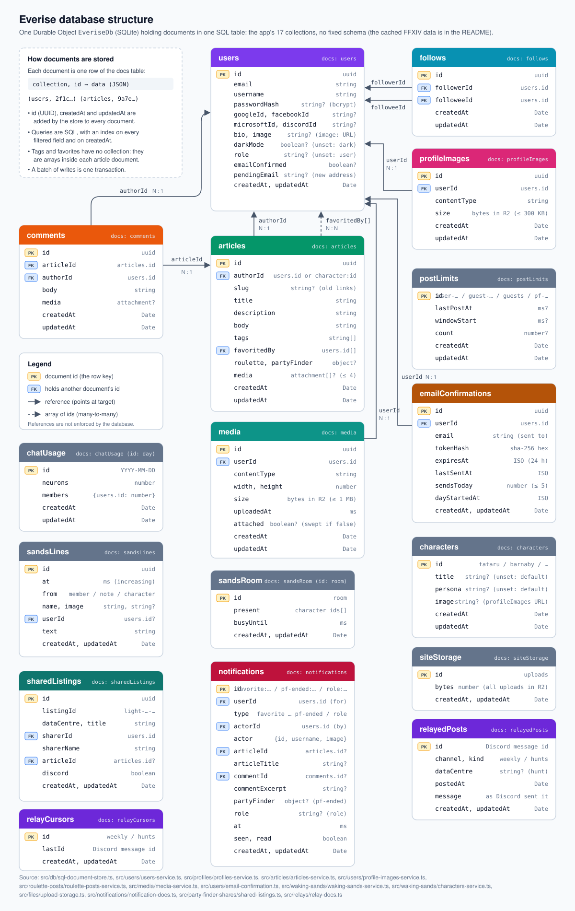

# Data model

The diagram is generated; the repository's `db-structure` skill says how to update it.

## The document store

All data is in SQLite, in the storage of one instance (`everise`) of the `EveriseDb` Durable Object. Documents live in the `docs` table, and the app's own bookkeeping in `meta` (`src/db`).

- **Documents.** Each document is a row with `collection`, `id`, its fields as JSON in `data`, and `created_at`/`updated_at`. In `data`, dates are stored as `{"$date": ms}` and bytes as `{"$bytes": base64}`.
- **Common fields.** Every document gets an `id` (a UUID, or the id given to `set`), `createdAt` and `updatedAt`. An update that changes nothing keeps the old `updatedAt`.
- **References.** Documents point to each other by id (`authorId`, `articleId`, `followerId`, `followeeId`). The database doesn't enforce these links; the services check them.
- **Arrays instead of collections.** An article's tags are in `tags`, and the members who favourited it in `favoritedBy`.
- **Queries.** `find` is one SQL query, with `==` and `array-contains` filters, sorting, and `LIMIT`/`OFFSET`. Every field a service filters on is indexed (`INDEXED` in `src/db/sql-schema.ts`). A new filter on another field needs a new index.
- **Consistency.** Each database call runs on its own, and a `batch` is one transaction. A service's read and its later write are separate calls, so changes that depend on current data use the one-step operations: `addToSet`/`removeFromSet` (favourites, who's in the Waking Sands room), `takeLease` (rate limits in `postLimits`), and the others in `src/db`.
- **Access.** The Worker reaches the Durable Object over RPC through `DurableObjectDb`. Tests use the same `SqlDocumentStore` on an in-memory `node:sqlite` database, so they run the real SQL.

## Main collections

| Collection | Holds |
|---|---|
| `users` | Accounts: username, email, password hash, role, `sessionVersion`, `darkMode`, character name and world, provider ids |
| `follows` | Who follows whom |
| `articles` | Posts, with `tags`, `favoritedBy`, `media`, and a `roulette` or `partyFinder` card |
| `comments` | Comments on posts |
| `profileImages`, `media` | Uploaded files' owners and details (the bytes are in R2) |
| `notifications` | Members' notifications, with ids that say what happened |
| `emailConfirmations`, `passwordResets`, `signInFailures` | Account security |
| `postLimits` | Rate-limit leases (Discord shares, Party Finder posts, roulette results) |
| `sharedListings` | Party Finder listings shared until they end |
| `relayedPosts`, `relayCursors` | Weekly and Hunts messages from Discord |
| `fflogsReports`, `fflogsClears`, `plannerGuestLookups` | The fight planner's FFLogs reads, and guests' hourly lookups |
| `chatUsage` | Workers AI Neurons spent per UTC day |
| `siteStorage` | Bytes all uploads keep in R2, against `UPLOAD_STORAGE_MB` |

## Data kept elsewhere

- **R2:** uploaded pictures (`profile-images/<id>`, `media/<id>`), cached game images (`game-images/<id>`) and relayed Discord pictures (`relays/<file>`).
- **`MarketHistoryHub`:** market price histories, one Durable Object per item and region.
- **The data centre's cache:** fight planner pull timelines.
- **Memory only, never stored:** events and venues, between requests.

## Durability

- Cloudflare stores the data durably. Locally it lives in `.wrangler/state`.
- No backup job runs. SQLite-backed Durable Objects keep 30 days of point-in-time recovery, which the app doesn't use yet.
- Every deploy counts articles before and after, and fails if any were lost.
- The instance name selects the storage: a different name means a different, empty database.
- Until October 2026 the documents were key-value entries. On its first start, the Durable Object copied them into the `docs` table (`src/db/key-value-copy.ts`), and left the old entries as a backup.
